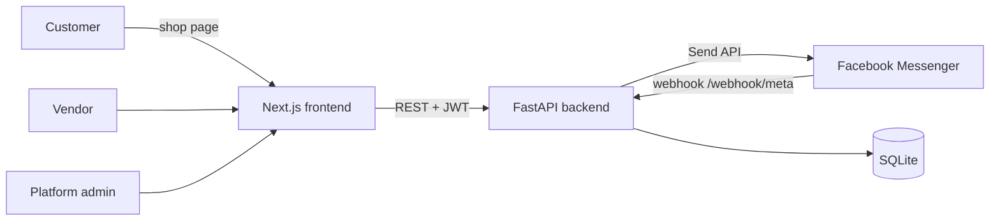

# AIOOMS - All-In-One Order Management System

> Every customer chat, one inbox. Turn Facebook, Instagram and shop-page messages into tracked orders, with stock and sales updated automatically.


Software Construction project, BESE-30, Military College of Signals (NUST). Course instructor: Sir Fawad Khan.

---

## The problem

Small online sellers in Pakistan get orders through Facebook, Instagram and chat apps. Messages are scattered across apps, orders live in notebooks or memory, stock is guessed, and nobody knows how much cash is still to be collected on delivery.

## The solution

AIOOMS gives each seller one place to:

1. Receive messages from every channel in one inbox, with a separate chat for each customer.
2. Reply from the same screen.
3. Turn a chat into an order in one click.
4. Track the order from Pending to Delivered, while stock updates itself.
5. See the day at a glance: orders, sales and cash to collect.

---

## Features

### Vendor (seller)
- Sign up and get a public shop link (`/business/<shop-slug>`).
- Manage products with sizes, colours, stock and a low-stock alert level.
- WhatsApp-style inbox: one chat per customer, newest first, auto-refresh every 5 seconds.
- Reply to customers (Facebook replies are delivered through Messenger).
- Chat-to-order: pick the size/colour from the conversation and create an order.
- Order status: Pending, Confirmed, Dispatched, Delivered, Returned, Cancelled.
- Dashboard: orders today, sales today, cash to collect (COD), low-stock items, orders by status, messages per channel, enquiries vs orders per product.

### Customer
- Open the seller's public shop page, browse products and search.
- Message the seller about a specific product. No account needed.

### Platform admin (owner)
- Platform overview: total, active and suspended vendors, new vendors (today, 7 days, 30 days), platform totals.
- Search every shop and see its products, orders, messages, sales and Facebook status.
- Suspend or reactivate a vendor. A suspended vendor cannot log in, their token stops working and their public shop returns 404.
- Admin sees counts only, never message text.

### Order and stock rules
- Creating an order reduces stock automatically. Ordering more than the stock is rejected.
- Cancelling or returning an order restores stock exactly once.
- A product is flagged low stock when a variant reaches its alert level.

---

## Channels

| Channel | Status | Notes |
|---|---|---|
| Shop page | Live | Customers message from the public shop page. |
| Facebook Messenger | Live, two-way | Webhook in, Send API out. Meta app is in Development mode, so only app Admins, Developers and Testers can message the Page. Public use needs Meta App Review. |
| Instagram DM | Simulated | Use the "Simulate message" form in the inbox. Live Instagram needs an Instagram Tester role and a separate app secret. |

---

## Architecture



Key design points:
- Analytics and admin summaries are pure functions (`summarize_*`), so they are unit-tested without a database.
- "Today" uses Pakistan time (UTC+5). SQLite datetimes are treated as UTC.
- Authentication uses JWT with bcrypt password hashes. Role (`vendor` or `admin`) is checked on the backend for every protected route.

## Tech stack

| Layer | Technology |
|---|---|
| Backend | Python, FastAPI, SQLAlchemy |
| Database | SQLite (`aiooms.db`) |
| Auth | JWT (OAuth2 password flow), bcrypt |
| Frontend | Next.js (App Router), TypeScript, Tailwind CSS v4 |
| Messaging | Meta Messenger Platform (webhook + Send API) |
| Testing | pytest, FastAPI TestClient, in-memory SQLite |
| Dev tunnel | ngrok (for the Meta webhook) |

## Project structure

```
aiooms/
+-- backend/
|   +-- main.py              FastAPI app and routes
|   +-- models.py            SQLAlchemy models
|   +-- analytics.py         Vendor dashboard summary
|   +-- admin.py             Platform admin summaries
|   +-- meta.py              Facebook Messenger integration
|   +-- create_admin.py      Create or promote an admin account
|   +-- add_admin_columns.py One-time DB upgrade for admin columns
|   +-- tests/               pytest test suite
+-- frontend/
    +-- app/
    |   +-- page.tsx         Landing page
    |   +-- login, register  Auth pages
    |   +-- dashboard        Seller dashboard and products
    |   +-- inbox            Chats and orders
    |   +-- business/[slug]  Public shop page
    |   +-- admin            Platform admin panel
    +-- components/          Shell, AuthShell
    +-- lib/api.ts           API client
```

---

## Getting started

### Prerequisites
- Python 3.10 or newer
- Node.js 18 or newer
- Git

### 1. Backend

```powershell
cd backend
python -m venv venv
.\venv\Scripts\Activate.ps1
pip install -r requirements.txt
uvicorn main:app --reload
```

The API runs at http://127.0.0.1:8000 and interactive docs are at http://127.0.0.1:8000/docs.
The SQLite database (`aiooms.db`) is created on first run.

If you have an older database from before the admin feature, run this once:

```powershell
python add_admin_columns.py
```

### 2. Frontend

```powershell
cd frontend
npm install
npm run dev
```

Open http://localhost:3000. The API address is set in `frontend/lib/api.ts` (`API_URL`, default `http://127.0.0.1:8000`).

### 3. Create the platform admin

```powershell
cd backend
python create_admin.py
```

It asks for an email and password (hidden input). Log in at `/login` with those details and you are taken to `/admin`. There is no admin sign-up page on purpose.

### 4. Try it without Facebook

1. Register a shop at `/register` and log in.
2. Add a product with sizes, colours and stock.
3. Open the shop link from the dashboard, click "Message seller" and send a message.
4. Open Inbox. Use "Simulate message" to create Facebook or Instagram chats.
5. Open a chat, click "Make order", then change the order status and watch stock and the dashboard update.

### 5. Connect a real Facebook Page (optional)

1. Create a Meta app with the Messenger product and add your Page.
2. Start the backend, then expose it with ngrok:
   ```powershell
   ngrok http 8000
   ```
3. In the Meta app, set the webhook callback URL to `https://<your-ngrok-domain>/webhook/meta`, use the verify token from `backend/meta.py`, and subscribe the Page to `messages`.
4. In the seller dashboard, connect the Page with its Page ID and Page access token.
5. In Development mode, add testers under App roles. Only they can message the Page.

Never commit access tokens, app secrets or ngrok tokens to Git.

---

## API overview

Full interactive documentation: `/docs` (Swagger UI).

| Area | Example routes |
|---|---|
| Auth | `POST /auth/register`, `POST /auth/login`, `GET /auth/me` |
| Products | CRUD under `/products` |
| Inbox and orders | list messages, reply, simulate, create order, set order status |
| Dashboard | `GET /dashboard/summary` |
| Public shop | `GET /shops/{slug}`, `POST /shops/{slug}/messages` |
| Messenger | `GET/POST /webhook/meta` |
| Admin | `GET /admin/overview`, `GET /admin/vendors?search=`, `PATCH /admin/vendors/{id}/active` |

### Access rules

| Who | Can do |
|---|---|
| Anyone | Open a public shop page and message a seller |
| Vendor | Everything about their own shop. Cannot open admin routes (403). |
| Admin | Platform overview, search shops, suspend and reactivate vendors. Admin accounts cannot be suspended. |
| Suspended vendor | Cannot log in. Existing tokens are rejected. Public shop returns 404. |

---

## Testing

```powershell
cd backend
pytest -v
```

17 automated tests:
- `test_dashboard.py` (9): today's numbers, cash to collect, low stock, status and channel counts, per-product performance, Pakistan-time boundaries, vendor isolation.
- `test_admin.py` (8): auth required, normal vendor gets 403, platform totals, vendor search, suspend blocks login, token and public shop, reactivate, admin cannot be suspended.

---

## Git workflow

- `main` is protected. Work on a feature branch (`feature/<name>`), push, open a Pull Request, then merge.
- After pulling the admin feature, run `python add_admin_columns.py` once.

## Roadmap

- Live Instagram DM integration (Instagram Tester role, separate app secret, webhook).
- Meta App Review and Live mode so any customer can message a connected Page.
- Polling fallback if webhooks are unavailable.
- Order export and printable delivery slips.

## Team

| Name | Role |
|---|---|
| Muhammad Rehan Sabir | System Designer |
| Waseem Abbas | Developer, repository owner |
| Amaan Shahid | Developer |
| Naqeeb | Testing |

## About

Academic project for Software Construction (BESE-30), Department of Computer Software Engineering, Military College of Signals, NUST.